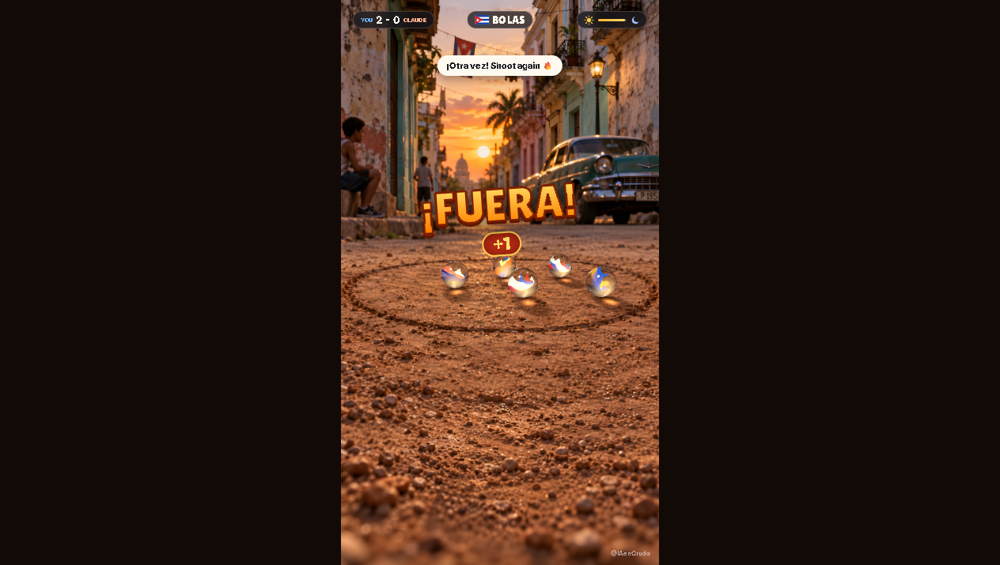

# STREET GAME — offline mirror

Full mirror of **THE STREET GAME** (https://street-game.centro-datos-crudo.workers.dev/).

Source: https://street-game.centro-datos-crudo.workers.dev/



## Stack

- **Vite production build** served at the origin root by Cloudflare Workers — one
  hashed bundle (`assets/index-HDif5lFa.js`) plus one stylesheet
  (`assets/index-BM9TqdBo.css`)
- **three.js inlined in the bundle** — the minified build embeds the three.js core
  and the WebGLRenderer implementation directly in the app chunk (no separate
  vendor chunk, no GLTF/DRACO addons)
- **self-hosted assets** — Inter (600/800) and Lilita One webfonts, PNG/JPG art,
  MP4 mother-voice clips and MP3 voice lines all ship from the same origin; no
  runtime CDN dependency

## What this is

THE STREET GAME (street-game.centro-datos-crudo.workers.dev) — "The marbles game
every Latino kid played on the street, rebuilt in 3D. Play against Claude until
your mom calls you home.": a Spanish-language 3D street-marbles game. You pick the
name you called them (BOLAS / CANICAS / METRAS / BOLITAS / CHIBOLAS / BOLINCHAS /
MARBLES → Cuba / Mexico / Venezuela / Argentina / El Salvador / Costa Rica / USA),
which selects the barrio backdrop and the mother's voice language, then drag back
and release to shoot; when a car pulls into the street you tap your marbles to
grab them before they scatter. Captured whole — entry document, app bundle
(three.js included), stylesheet, 32 webfont files, the barrio/art/marble imagery,
the mother-video and voice-line media, favicon and OG image: **53 files,
14,641,478 bytes**. The runtime graph is closed to a fixpoint (see the derivation
note) and the capture is byte-exact under `.upstream/manifest.json`.

External: none at runtime — the page and its JS load nothing off-origin. The only
outbound reference is the share-intent link `https://x.com/intent/post` (navigates
away on the SHARE button, not a dependency).

## Layout

- `.upstream/manifest.json` — sha256 for every captured file (Gen-A)
- `readable/` — prettified derived layer (pinned prettier 3.9.6) for the app
  bundle and the stylesheet
- `src/` + `split-spec.json` — statement-aligned slices of the app code with the
  recorded derivation spec
- `docs/cover.png` — gameplay cover; `docs/boot-2026-10-12.png` — boot evidence
- `tools/capture.mjs` — byte-exact capture + runtime-closure fetch (`--check` for
  a residual closure audit)
- `tools/derive.mjs` — rebuild `readable/` + `src/` + `split-spec.json`
- `tools/verify.mjs` — re-hash the capture against the manifest
- `tools/update.mjs` — read-only drift probe against the live origin
- `tools/audit.js` — integrity gate for the derived layers (`AUDIT PASS`)
- `tools/serve.mjs` — dependency-free loopback static server for boot tests
  (`node tools/serve.mjs <port> [root]`)

## Assets

- **images** — 14 file(s): `arte/` (fondo_cuba.jpg, fondo_mexico.jpg,
  fondo_neutro.jpg, mama.jpg, mano_tira.png, nino.png, mano_abierta_d.png,
  mano_abierta_i.png, mano_cerrada_d.png, mano_cerrada_i.png), `assets/`
  (carro-C04VNCdo.png, mano-NEGbzcxz.png), plus `favicon.png`, `og.jpg`
- **fonts** — 32 file(s): `assets/` — Inter cyrillic/cyrillic-ext/greek/greek-ext/
  latin/latin-ext/vietnamese at 600 and 800 (woff + woff2) and Lilita One
  latin/latin-ext 400 (woff + woff2)
- **video** — 2 file(s): `arte/` (mama_es.mp4, mama_en.mp4 — the Spanish/English
  mother cutscenes)
- **audio** — 2 file(s): `arte/` (voz_mama_es.mp3, voz_mama_en.mp3 — the mother's
  voice lines)

## Run

Open `index.html` through any static file server (the capture is a static site
served at the origin root; no build step):

```
npx serve .
```

## Verify

```
node tools/verify.mjs        # re-hash the capture against the manifest
node tools/audit.js          # derived-layer integrity gate → AUDIT PASS
node tools/capture.mjs --check   # residual closure audit → 0 unresolved
node tools/check-exports.mjs     # the derived layer still exports every public name
```

## Boot test (2026-10-27)

- Entry: `http://127.0.0.1:4969/` served by `tools/serve.mjs` with the network
  blocked (`MAP * 127.0.0.1`).
- Outcome: **rendered** — the country menu appeared over the Cuba barrio 3D
  scene; BOLAS + PLAY started a round with the marbles playfield, the hand and
  the HUD (YOU 0 - 0 CLAUDE).
- Evidence: body 395 chars (193 during gameplay); canvas 319x568; 0 console
  errors; 0 failed same-origin requests, 0 blocked cross-origin; screenshot
  `docs/boot-2026-10-27.png`.
- Gaps seen: none.

## Updating from upstream

```
node tools/update.mjs        # read-only drift probe: what changed upstream
```

The probe never rewrites the capture — a mirror is a point-in-time snapshot.
Refreshing means re-fetching into a clean tree (`node tools/capture.mjs`), copying
the replaced files under `legacy/<date>/` first (PLAN §3), re-cutting the manifest,
and re-deriving `readable/` + `src/` from the new bundle with `node tools/derive.mjs`.
The origin serves the site at the root, so the capture sits at the repo root:
`DISK_PREFIX=""` and `ENTRY="index.html"` in the probe.

### 2026-10-12 capture + readable/src derivation

- **Capture** (byte-exact, nothing edited): 53 files, 14,641,478 bytes — entry
  `index.html` (5,945 B), `assets/index-HDif5lFa.js` (585,296 B),
  `assets/index-BM9TqdBo.css` (13,737 B), 32 fonts, 14 images, 2 videos, 2 audio
  clips, favicon + og.jpg. Closure was driven to a fixpoint by
  `tools/capture.mjs`: static HTML refs, `import` specifiers, `new URL(…)`,
  `__vite__mapDeps`-style chunk tables and asset-path literals; relative JS paths
  are ambiguous at capture time (document base vs module base), so each candidate
  is probed module-first then root-first and the first HTTP 200 wins. Two
  runtime-instantiated template literals (`./arte/mama_${e}.mp4`,
  `./arte/voz_mama_${e}.mp3` with e ∈ {es, en}) are enumerated explicitly. Final
  audit: `49 reference group(s), 0 unresolved`; a browser network log recorded
  while playing (16 requests: entry, bundle, stylesheet, all four images loaded at
  runtime, fonts, the MP4 and the voice MP3) contains only files the capture
  carries. No genuine 404 gaps upstream.
- **readable/** — pinned prettier 3.9.6 (module API, default options, single pass
  verified idempotent — never the CLI, it respects `.gitignore` and can silently
  echo its input) rendered the app bundle to
  `readable/assets__index-HDif5lFa.pretty.js` (26,460 lines) and the stylesheet to
  `readable/assets__index-BM9TqdBo.pretty.css` (802 lines). Every pretty is
  provably not a byte copy of its capture source and re-renders byte-exact under
  the pinned version.
- **src/** — 8 statement-aligned slices (`src/assets__index-HDif5lFa-NN.js`, exact
  2-line provenance header) recorded in `split-spec.json` (12 sections): 8/8 parse
  standalone (`node --input-type=module --check -`) and round-trip byte-exact to
  their readable line ranges. Cuts land only on top-level declaration boundaries
  (~250-350 line windows; the 680-line engine class and 253-line audio class stay
  whole). Numbering starts at the app's level-config block and ends at the boot
  call (`Yu();`).
- **Vendor rule — wholeFile sections, never sliced**: the Vite modulepreload
  polyfill opening the bundle (lines 1-31), the bundled three.js core (lines
  32-22,656: math/constants, layers, events, color management, textures,
  geometries, materials, `window.__THREE__` registration, shaders — content-
  anchored and guarded by `__THREE__`/`DFG_LUT`/`WebGLRenderer`/
  `MeshPhysicalMaterial`) and the bundled three.js WebGLRenderer implementation
  (lines 22,657-24,293). The minifier merged the app's level-config declarators
  (`q, cl, ll, ul, dl, fl, pl, ml, hl, gl, _l, vl`) into the SAME top-level `var`
  statement as the WebGLRenderer class; the class declarator is the renderer
  wholeFile region, and the app declarators (lines 24,294-24,497) are one explicit
  ranged slice — `assets__index-HDif5lFa-01.js`, titled *barrio* — whose body is
  the exact declarator list text (a syntactically standalone comma-chain of
  assignments, byte-exact against its readable range). Stylesheet rule:
  `assets/index-BM9TqdBo.css` is wholeFile.
- **notRendered** — 50 hashed payload records in `split-spec.json` (14 images,
  32 fonts, 2 videos, 2 audio; bytes + sha256, no pretty pass). The entry document
  has zero inline `<script>`/`<style>` content blocks, so there are no `*-inline-N`
  twins and no `index-inline-map.json`.
- **Gates**: `node tools/verify.mjs` → `53 files checked, 0 problems`;
  `node tools/audit.js` → `AUDIT PASS` (8/8 round-trips, 2/2 pretties re-render
  byte-exact, 12 sections); `node tools/capture.mjs --check` → `0 unresolved`;
  `node tools/update.mjs` → `up to date: 53 captured files identical upstream`.
  Boot test: mirror served on loopback (`npx serve .`), opened through opencli —
  the country menu rendered, CUBA/BOLAS selected, PLAY pressed, a drag-back shot
  released on the canvas; cover shows the live round (score YOU 2 - 0 CLAUDE,
  ¡FUERA! +1) and `docs/boot-2026-10-12.png` the armed hand-and-marbles playfield;
  the listener PID was killed and the port proven closed (`netstat`).
- **§0.4 fork-over-mirror checked 2026-10-12**: no public upstream source repo
  exists — the capture contains zero `github.com`/`gitlab.com` references (credits
  point to the X account @IAenCrudo and "made by Claude Opus 5.5"; the portal
  publishes the deployment, not sources), and GitHub searches for the project
  return nothing, so the mirror stands.
- **Open task (PLAN §5)**: identifiers in `src/` are the bundle's own minified
  names; the deep identifier-rename campaign is not yet done. Rebuild the derived
  layers any time with `node tools/derive.mjs`.

## Mirror conventions

- **Capture layer** — the captured files are byte-exact copies of what the origin
  served; nothing in them is edited. `.gitattributes` pins `* -text` so git never
  normalizes EOLs.
- **Vendor integrity** — three.js, the webfonts and the media stay byte-exact as
  served; `readable/` never rewrites vendor bytes (vendor regions are indexed
  whole, never sliced).
- **Readable layer** — `readable/` is derived (prettified) and never shipped to a
  browser; it exists so the bundle can actually be read.
- **Provenance** — `.upstream/manifest.json` records sha256 for each captured
  artifact, and `tools/verify.mjs` re-checks it; `_mirror-report.json` is the
  crawl record.
- **Drift** — `tools/update.mjs` is read-only: it reports what changed upstream
  and never rewrites the capture.

## Fleet status

<!-- mirror-status:start — feeds _standard/REPO-INDEX.md. Update ONLY your own mirror's block; never edit the shared index (PLAN §8). Rebuild: node _standard/build-index.mjs -->
<!-- cols: cls=classification · ver=verify 0 problems · upd=drift probe · man=manifest · rdbl=readable re-derived · src=reversed src · boot=boot test · top=offline-mirror topic · tag=backup tag · staged=staged not committed -->
| # | repo | cls | ver | upd | man | rdbl | src | boot | top | tag | staged |
|---|---|---|---|---|---|---|---|---|---|---|---|
| 291 | street-game | mirror | ✓ | ✓ | ✓ | ✓ | ✓ | ✓ | ✓ | — | — |
<!-- mirror-status:end -->
